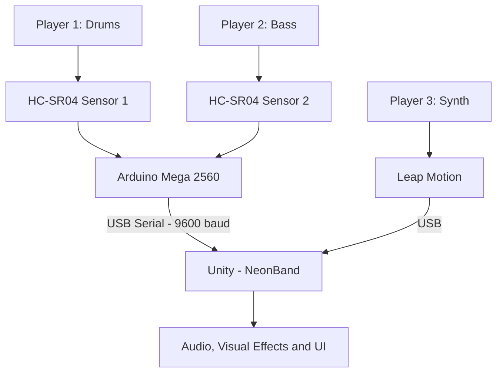
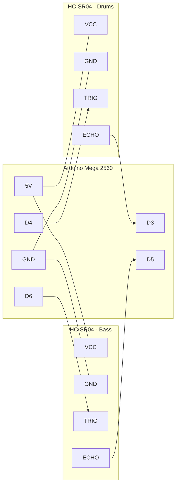

[README (1).md](https://github.com/user-attachments/files/35437534/README.1.md)

https://github.com/user-attachments/assets/d84cf0dc-fa1b-4ec6-a748-99d2bb6c3ee2

# NeonBandGame — Hardware Design

NeonBand is a three-player interactive music game built with Unity, Arduino and Leap Motion. Each player controls a different instrument through hand movements. Unity generates the sound, visual effects and interface feedback.

## 1. System architecture

## 2. Hardware requirements

| Component | Quantity |
|---|---:|
| Arduino Mega 2560 | 1 |
| HC-SR04 ultrasonic sensor | 2 |
| Leap Motion controller | 1 |
| Breadboard | 1 |
| Jumper wires | As needed |
| USB cables | 2 |
| Computer | 1 |

No external buzzer is required. All instrument sounds are played by Unity.

## 3. Wiring diagram

| HC-SR04 pin | Drums sensor | Bass sensor |
|---|---|---|
| VCC | 5V | 5V |
| GND | GND | GND |
| TRIG | D4 | D6 |
| ECHO | D3 | D5 |

Both sensors share the 5V supply and ground through the breadboard. Each sensor has independent TRIG and ECHO connections. Follow the printed pin labels on the physical sensors. Connect the Leap Motion directly to the computer via USB, not to the Arduino.

[Arduino Mega 2560 official pinout](https://docs.arduino.cc/resources/pinouts/A000067-full-pinout.pdf)

## 4. Interaction design

### Drums and Bass

Players move their hands within the ultrasonic sensors' distance zones.

| Nominal hand distance | Drums | Bass |
|---|---|---|
| 5–15 cm | Kick | C |
| 15–25 cm | Clap | F |
| 25–35 cm | Hi-Hat | G |
| 35–45 cm | — | A |

The Arduino sends a note event when the detected distance enters a different valid zone.

### Synth

Leap Motion tracks the player's hand. Horizontal movement selects one of seven notes (C, D, E, F, G, A, B). Lowering the hand triggers the selected note; raising it prepares the next press.

## 5. Arduino–Unity communication

The Arduino sends newline-terminated serial messages at 9600 baud.

| Drums | Bass |
|---|---|
| `DRUM:KICK` | `BASS:C` |
| `DRUM:CLAP` | `BASS:F` |
| `DRUM:HAT` | `BASS:G` |
| — | `BASS:A` |

In Unity, `ArduinoBandManager` uses `ArduinoBandInput.cs` to receive messages and forward them to `NeonBandManager`. Set the actual serial port in the Inspector and enable Arduino input when the hardware is connected. Close the Arduino Serial Monitor before connecting Unity.

## 6. Prototype status

The Unity software and Leap Motion interaction have been implemented. The dual-sensor Arduino design still requires physical integration testing. Distance thresholds, sensor placement and potential ultrasonic interference may need adjustment during testing.
